# Agentic RFP Evaluation and Supplier Ranking

This Streamlit classroom app compares supplier PDFs for one fictional council procurement. It reads active criteria from SQLite, obtains evidence-based criterion scores from the selected LLM provider in live mode, validates those scores, and calculates peer benchmarks and rank in deterministic Python. The bundled demo mode uses fixed classroom scores so anyone can try the interface without an API key; it is clearly labelled and does not claim to be an LLM evaluation.

## Quick start

Use Python 3.12 or 3.13. From this `Code` directory:

```powershell
python -m venv .venv
.venv\Scripts\Activate.ps1
pip install -r requirements.txt
python setup/init_db.py
streamlit run src/app.py
```

On macOS/Linux, activate with `source .venv/bin/activate`. Open the Streamlit URL, choose **Demo: bundled proposals**, leave the default four selected, then click **Evaluate batch**. Open **Saved runs** to retrieve the result. Download JSON from the result panel.

For live evaluation, choose a provider and model in the **left sidebar**, then paste that provider's API key into the password field. Supported providers are OpenAI, Anthropic Claude, Google Gemini, Cohere.ai, and OpenRouter. The sidebar includes two model choices per provider and a custom model ID option (OpenRouter IDs use a `provider/model` format). The pasted key is used for that session's API calls; it is never stored in SQLite or exported JSON. You may instead configure a provider-specific environment variable or an uncommitted `.streamlit/secrets.toml`:

```toml
OPENAI_API_KEY = "your-key"
# Optional alternatives:
# ANTHROPIC_API_KEY = "your-key"
# GEMINI_API_KEY = "your-key"
# COHERE_API_KEY = "your-key"
# OPENROUTER_API_KEY = "your-key"
```

Select **Live: uploaded PDFs + selected LLM**, upload at least two PDFs, enter a unique supplier name, submission date and historical experience rating (0–10) for each, then evaluate. Live calls incur API usage. The selected provider and model are saved with the run for traceability; the key is not. Request, authentication, model and response errors appear as toast notifications and in the page. OpenRouter custom models must support structured outputs.

## Project layout

| Path | Purpose |
| --- | --- |
| `src/app.py` | Criteria editor, upload workflow, leaderboard, detailed scorecard and JSON download |
| `src/seed_db.py` | SQLite schema, seeded active criteria and database access |
| `src/workflow.py` | Orchestration, PDF extraction, evidence check and atomic run persistence |
| `src/llm.py` | Shared evidence-grounded prompt and structured JSON calls for all five providers |
| `src/engine.py` | Result normalization, formulas, benchmarks and ranking |
| `src/sample_data.py` | Fictional proposal source data for classroom examples |
| `setup/` | Database initialization and reproducible sample/example generators |
| `data/` | Local SQLite database (`rfp_evaluation.db`, excluded from Git) |
| `examples/sample_rfps/` | Ten selectable-text, three-page sample PDFs |
| `examples/example_run.json` | Example completed four-supplier demo export |
| `examples/demo.py`, `examples/DEMO_OUTPUT.md`, `tests/` | Terminal demonstration, observed output and focused verification |
| `AGENTS.md`, `PROJECT_SPEC.md`, `DEPLOYMENT.md` | Coding-agent, acceptance and cloud deployment instructions |

## Workflow

```mermaid
flowchart LR
  UI[Streamlit input] --> DB[Load active SQLite criteria]
  DB --> PDF[Extract PDF text]
  PDF --> AI[LLM criterion evaluation]
  AI --> V[Validate JSON and evidence]
  V --> S[Python weighted scoring]
  S --> P[Peer benchmarks and PPI]
  P --> R[Deterministic tie-break and rank]
  R --> SAVE[SQLite complete run]
  SAVE --> VIEW[Leaderboard, scorecard and JSON]
```



The PDF and criteria are data supplied to the evaluator. The selected LLM is asked for one criterion result per active criterion with a direct evidence quote. The app checks that each positive-score quote appears in extracted PDF text; unsupported scores become zero with warnings. API failure stops the batch before it is saved. A scanned PDF with no selectable text needs OCR and is rejected.

## Scoring rules

Active weights must total 100. Scores use the criterion maximum held in SQLite, not a maximum proposed by the LLM.

- Absolute score out of 100: `Σ(score / max_score × weight)`.
- Criterion benchmark: highest validated score among the suppliers in the batch.
- Gap: `supplier score − benchmark` (zero for a leader; negative otherwise).
- Relative performance: `score / benchmark × 100`; if **all** suppliers score zero, it is defined as 100% for all so an unevidenced criterion does not create a peer advantage.
- PPI out of 100: `Σ(relative performance × weight / 100)`.
- Rank order: higher unrounded PPI, earlier ISO submission date, higher historical experience rating, then supplier name ascending. Sequential ranks start at 1 after sorting.

Malformed JSON, missing criteria, nonnumeric scores and duplicate IDs produce visible warnings. Missing or invalid scores become zero; finite out-of-range scores are clipped. Unknown IDs are ignored. The criteria snapshot, scorecards, warnings, formula notes and final ordering are stored as one run. Each supplier also has a row in `supplier_results`.

## Criteria and sample data

Five example criteria are seeded at weights 30/20/20/20/10 and maxima of 10. Edit active status, description, weights and maxima in the **Criteria** tab; the active weights must still total 100. Existing runs keep their original criteria snapshot. The ten proposals all answer the same Northstar Borough Council request, with varied pricing, milestones, controls and gaps. `python setup/generate_samples.py` recreates the PDFs from fictional source data; `python setup/generate_example.py` rebuilds the example run JSON.

## Demonstration and tests

```powershell
python examples/demo.py
python -m unittest discover -s tests -v
```

`examples/demo.py` prints one successful four-supplier leaderboard and a malformed-score example (an oversized score and four missing criteria). The tests cover all ten PDF extractions, SQLite round-trip, score clipping, missing criteria, zero benchmarks and the tie-break chain. Live API output was not exercised without an API key.

For a submission demonstration, capture these application screenshots after running or deploying it: the Criteria tab, the four-supplier leaderboard, an expanded detailed scorecard with evidence and a validation warning or rejected unreadable PDF. The included JSON is a machine-readable artifact of the successful run.

## Assumptions and limits

The app is designed for fictional classroom documents. It caps uploads at 10 MB and 30 pages and sends up to 45,000 extracted characters per supplier to the LLM. It has no OCR. Historical experience is user-supplied and affects only tie-breaks. The local SQLite file is excluded from Git. On Streamlit Community Cloud, local file storage is not guaranteed to persist, so users should download important run JSON immediately; durable multi-user history would require an external database. See [Streamlit's data connection guidance](https://docs.streamlit.io/develop/concepts/connections/connecting-to-data).

For cloud release steps, see [DEPLOYMENT.md](DEPLOYMENT.md).
